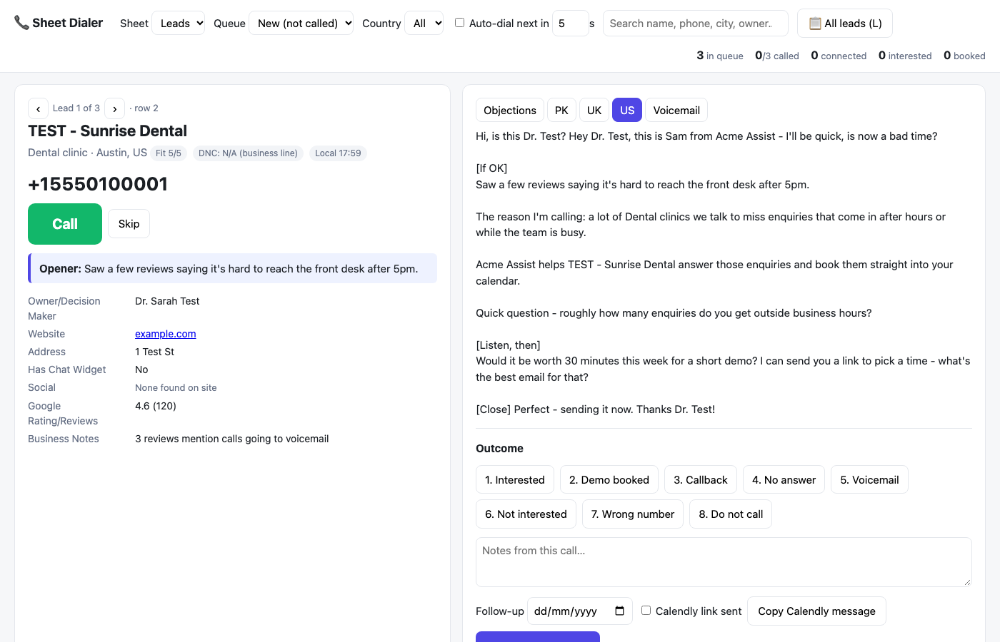
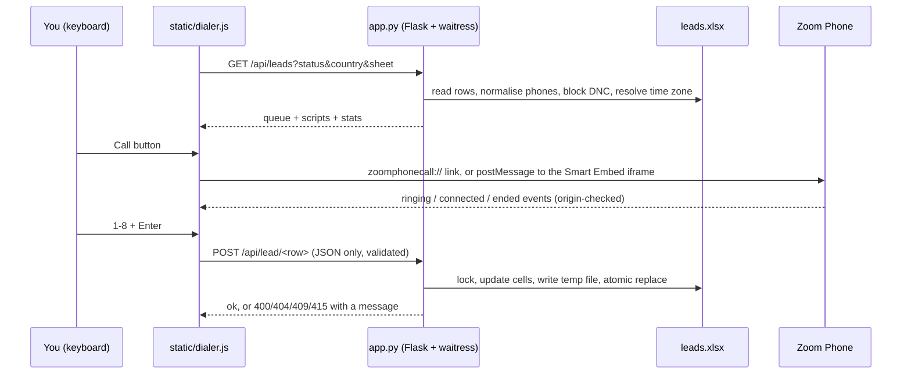

# Sheet Dialer

A keyboard-driven power dialer for B2B cold calling: it turns a lead spreadsheet into a one-at-a-time call queue with a personalised script, dials through Zoom Phone, and writes every outcome back to the sheet.

**Stack:** Python · Flask · openpyxl · vanilla JavaScript · Zoom Phone (URL scheme / Smart Embed) · pytest · GitHub Actions



## The problem

I built this in Sep–Oct 2026 for outbound calling campaigns I was running to small businesses (clinics, agencies, brokers) in the US and Canada. The leads lived in a spreadsheet. Every call meant copying a number into Zoom, finding the right script, then typing the outcome and a follow-up date back into Excel by hand. That's slow, and it's easy to call someone twice or forget a callback.

The usual fix is a paid power dialer. Those are priced per seat and expect you to move your leads into their CRM. I wanted to keep the spreadsheet as the source of truth and use the Zoom Phone line I already had. I used it on my own campaigns: around 120 call outcomes logged.

## What it does

- **One lead at a time**, sorted by fit score, with queues for *new*, *follow-up due* and *all*.
- **Scripts filled from the row**: owner name ("Dr. Jane Roe" becomes "Dr. Roe"), business, category, a personalised opener. US, UK and PK (Roman Urdu) variants, chosen by the lead's country.
- **One-key dialing** through the Zoom desktop app (`zoomphonecall://`), or inside the page with Zoom Phone Smart Embed. In embed mode an unanswered call is marked "No answer" automatically, and the call length is saved.
- **Outcomes go back to the same .xlsx**: status, timestamped notes, follow-up date, attempt count. Excel stays usable alongside the app.
- **Phone numbers are normalised to E.164** across US/CA/UK/PK formats. Numbers that can't be valid aren't dialed.
- **Keyboard first**: `1–8` pick outcome · `Enter` save and next · `←`/`→` previous/next lead · `/` search · `L` all-leads table · `Esc` cancel auto-dial.
- **Auto-dial**: after a save, the next lead is dialed after a countdown you can cancel.

### Compliance built into the code

- **Do-not-call is enforced on the server.** Once a lead is marked *Do not call* or *Wrong number*, its number is never sent to the browser again. No queue, search, table or auto-dial can call it.
- **Calling hours.** Each lead's local time comes from a `Timezone` column (or its country, for single-zone countries). Outside 8am–9pm local time, auto-dial pauses and a manual call needs an explicit confirm.
- No recording, and no prerecorded or AI voice. A human makes every call.

These are guardrails, not legal advice. Check the rules where you call: US TCPA and National DNC, Canada DNCL, UK TPS/CTPS.

## Architecture



- `app.py` is the whole backend: reading and writing the workbook, validation, access control.
- `templates/dialer.html`, `static/dialer.js` and `static/dialer.css` are the UI, with no framework and no build step.
- `make_sample.py` creates a workbook with the expected columns, generic scripts and 3 fictional leads.

## Decisions and trade-offs

- **The spreadsheet is the database.** Zero migration, and non-technical teammates can still edit it in Excel. The cost: every save rewrites the whole file. So saves run one at a time under a lock, and go through a temp file plus `os.replace` so a crash can't corrupt the sheet. If two people needed it at once, SQLite with xlsx import/export would be the next step.
- **Zoom URL scheme by default, Smart Embed as an option.** The URL scheme works with no admin setup. Smart Embed gives call events (ringing, connected, ended) for automatic no-answer handling and call duration, but Zoom only allows it on an approved HTTPS domain, which means running a tunnel such as ngrok.
- **Local-first access control.** With no password set, the app answers only on `localhost` and refuses any other host, so a tunnel can't expose it by accident. In tunnel mode it needs a password of at least 12 characters, and failed logins are throttled.
- **The server decides what's dialable.** DNC and invalid-number checks happen before data reaches the browser, so a UI bug can't place a blocked call.

## How I verified it

- `pytest` runs 43 tests on fictional data. They cover E.164 normalisation per country, queue filters, the save route (JSON-only, row bounds, field validation), parallel saves not losing updates, Do-not-call never being dialable, time-zone resolution, and the password and throttling rules.
- `ruff check .` lints. CI runs both on Python 3.9 and 3.12, plus a gitleaks secret scan.
- Manual: used in link mode (Zoom desktop app) on my own campaigns. The screenshot above is the app running on the sample data.

## Run locally

```bash
python3 -m venv .venv && source .venv/bin/activate
pip install -r requirements.txt
cp config.example.json config.json   # set your name, product, Calendly link
python make_sample.py                # creates leads.xlsx with 3 fictional leads
python app.py                        # http://localhost:5050
```

You can work the queue, pick outcomes and save without a Zoom account. The **Call** button needs the Zoom desktop app signed in with Zoom Phone.

Your real `leads.xlsx` and `config.json` are gitignored. Keep it that way: lead sheets hold other people's personal data.

<details>
<summary>In-page calling with Zoom Smart Embed (optional)</summary>

1. Expose the app over HTTPS, e.g. `ngrok http 5050 --url=<your-name>.ngrok-free.app`.
2. Set `access_password` (12+ characters) in `config.json`. The app refuses non-localhost requests without one.
3. Ask your Zoom admin to install *Zoom Phone Smart Embed* and approve that domain.
4. Set `"zoom_mode": "embed"` and open the HTTPS URL. Sign in to Zoom inside the panel once.

</details>

## Testing

```bash
pip install -r requirements-dev.txt
ruff check . && pytest
```

## Security

See [SECURITY.md](SECURITY.md).

## License

[MIT](LICENSE)
